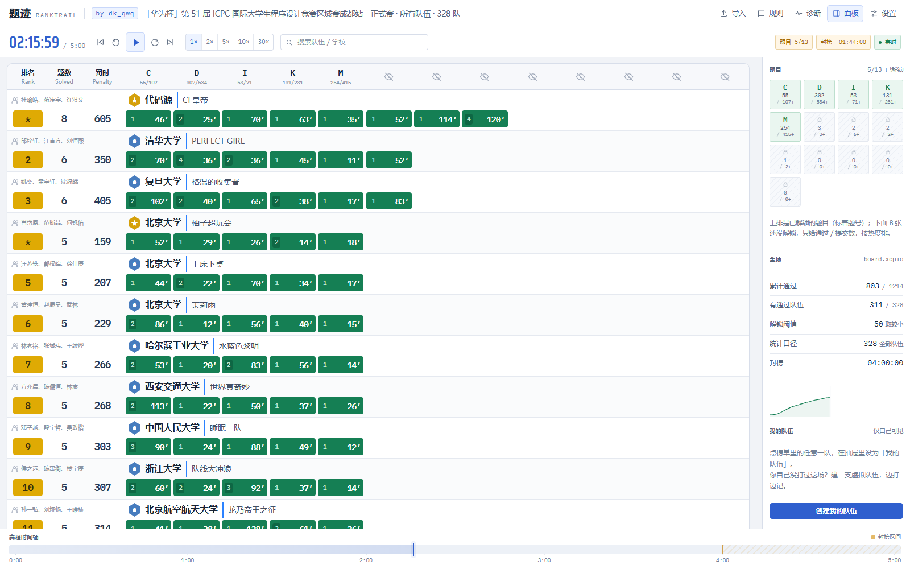
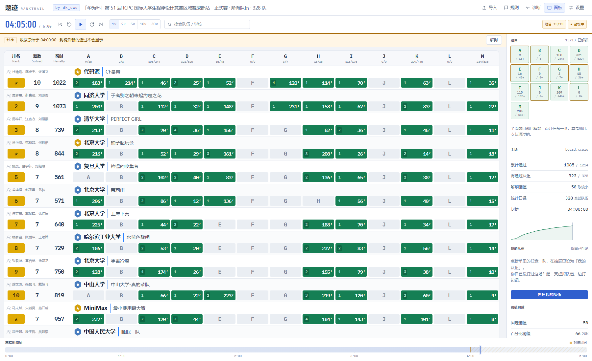

# 题迹 RankTrail

**面向算法竞赛训练的榜单回放工具，由 [dk_qwq](https://github.com/dk-qwq) 维护。**

题迹采用浅色界面，支持赛时匿名追榜、封榜逐题回放、金银铜排名和虚拟队伍。感谢上游作者的开源工作。

[在线使用](https://dk-qwq.github.io/ranktrail/) · [源代码](https://github.com/dk-qwq/ranktrail) · [上游项目](https://github.com/Silverwolfnya/fogboard)

## 使用方式

打开网站后可选择内置的成都站 / 秦皇岛站示例，也可以拖入自己的榜单文件。支持 xlsx、board.xcpcio 提交流水 JSON，以及 QOJ 榜单的文本、HTML 或抓取脚本 JSON。

这是纯前端应用：导入文件在浏览器中解析，设置和虚拟队伍记录保存在本机浏览器的 localStorage 中。换浏览器或清理站点数据后，这些本地记录不会自动恢复。

### 本地开发

需要 Node.js 24 和 pnpm 11.23.0，依赖版本由锁文件固定。

~~~bash
pnpm install --frozen-lockfile
pnpm dev
~~~

开发地址为 <http://127.0.0.1:5173/>。

~~~bash
pnpm test               # 解析、排名、解锁、快照、回放时钟与虚拟队伍等单元测试
pnpm typecheck          # TypeScript 类型检查
pnpm build              # 构建 dist/，用于静态托管
pnpm preview            # 在 http://127.0.0.1:4173/ 预览构建结果
pnpm build:single       # 构建 dist-single/RankTrail.html 单文件版
pnpm verify:board       # 揭题靠左、匿名、封榜、奖牌与时间精度的浏览器检查
pnpm verify:responsive  # 浅色界面、桌面列宽、小屏面板与滚动检查
~~~

浏览器检查脚本使用 Playwright 与本机 Chrome；可按需运行 package.json 中的其他 `verify:*` 脚本。浏览器检查和单元测试属于本地验证，不代表比赛官方对赛制实现的认证。

### 单文件版

`pnpm build:single` 会把 JS、CSS、字体和内置示例内联到 `dist-single/RankTrail.html`。可以用现代浏览器直接打开这个文件，无需启动本地服务器；使用内置示例和导入本地文件也无需联网。

## 榜单与回放规则

默认比赛时长 5 小时，第 4 小时封榜，每次错误提交罚时 20 分钟。规则可以在设置中调整。

| 阶段 / 功能 | 显示方式 |
| --- | --- |
| 赛时 | 已揭题按题号排列，固定在主榜最左侧，所有队伍上下对齐；剩余题目继续匿名，在每队内部按首次提交时刻排列。只有聚合数据时，首次提交时刻未知，通过格按已知通过时刻排列。 |
| 揭题 | 默认通过队伍数达到 `min(50, ⌈20% × N⌉)` 时揭题，其中 N 为当前统计口径的队伍数。题卡亮起后，对应题格从匿名区移入左侧固定列。 |
| 封榜 | 默认 4:00 时所有题卡亮起，主榜恢复 A、B、C…完整逐题布局，榜面数据停在封榜时刻。 |
| 终榜 / 手动解封 | 显示当前回放时刻的完整逐题数据；到比赛结束时显示终榜。 |
| 排名底色 | 默认累计前 10% 为金色、10%–30% 为银色、30%–60% 为铜色，其余浅灰。阈值人数取四舍五入，并列名次一起处理；一题未过的队伍不显示奖牌色。 |

题卡显示实算的通过数和可还原的提交数。尚未揭题的题卡隐藏题号，按热度排序。对于没有逐条提交时间的聚合数据，未知时刻的错误提交不会伪造为赛时事件。

设置中还可调整揭题人数 / 百分比及二者关系、封榜时刻、比赛时长、罚时、全部队伍 / 仅正式队统计口径、我的队伍和奖牌线比例。调试选项「显示完整信息」会提前展示题号与数据，训练时请按需开启。

### 虚拟队伍

导入榜单后，可以创建「我的队伍」，在回放过程中记录自己的通过与错误提交：

- 右栏选择题号，再点击「通过了」或「没通过」，记录使用当前回放时刻。
- 可撤销最后一条、清空记录或移除队伍；记录按榜单保存在本地。
- 虚拟队伍参与排名，在「仅正式队」口径下也会保留。
- 虚拟队伍不计入揭题人数、首杀和全场官方通过统计。
- 封榜期间默认连自己的榜面行也冻结；右栏账本可继续记录。设置中的「封榜中实时」可单独让自己的榜面行继续更新。

「我的队伍」的逐题明细始终可见，因为选手知道自己的提交；它仍遵循上面说明的封榜数据时刻。

### 回放时钟与快捷键

回放使用墙钟时间与倍速推算进度。浏览器切到后台后，返回时会追平经过的时间；系统时间倒退不会让回放倒退。

`空格` 播放 / 暂停 · `← / →` 前后 10 秒 · `Shift + ← / →` 前后 1 分钟 · `Home / End` 开头 / 终榜 · `U` 解封 / 复原 · `Esc` 关闭弹层。选中虚拟队伍题号后，`Enter` 记录通过，`Backspace` 记录错误。

## 数据导入与边界

### board.xcpcio 提交流水

可从对应赛事的 `config.json`、`team.json`、`run.json` 合并得到导入文件。仓库提供辅助脚本：

~~~bash
node scripts/fetch-xcpcio.mjs "https://board.xcpcio.com/ccpc/11th/chongqing?group=official"
# 输出 fixtures/xcpcio-chongqing.json
~~~

脚本会联网读取你指定赛事的公开数据。把生成的 JSON 拖入页面即可。逐条提交包含秒级时间时，回放能展示每次错误提交与通过，匿名题格按该题的首次提交时间排列。站点接口或访问策略变化时，下载脚本可能需要调整。

### board.xcpio / xcpclink 的 xlsx 导出

解析器会识别多张工作表、表头位置、正式 / 打星标记、队伍、学校与成员信息。

| 来源 | 常见单元格 | 次数含义 |
| --- | --- | --- |
| board.xcpio | `+k(mm)`、`-n`、`-` | 通过格的 k 为提交总次数，含通过的一次；mm 为分钟。 |
| xcpclink | `AC/k/H:MM:SS`、`FB/k/H:MM:SS`、`RJ/n` | 通过格的 k 为提交总次数；FB 表示首杀，时刻精确到秒。 |

通过题罚时按 `通过时刻 + 错误次数 × 每次罚时` 重算。诊断面板会提示原榜数据与实算统计之间的差异。

### QOJ 榜单

分页榜单请在题迹的导入框点「复制全榜抓取脚本」，再到 QOJ 榜单页打开开发者工具（F12），在控制台运行脚本。脚本会合并各页并复制 JSON，完成后回到题迹点「粘贴并导入」。直接复制榜单页文本或导入另存的 HTML 会导入当前页。需要登录或遇到访问挑战时，先在浏览器中正常打开榜单。

QOJ 的 `+k` 表示 k 次错误后通过，因此提交总次数为 k + 1；`*+` 表示首杀，`-n` 表示错误提交。时间通常按 `h:mm` 解析，解析器也会结合罚时尝试识别 `m:ss`。导入数据必须包含通过时刻，只有通过标记而没有时间的榜单无法生成可靠回放。

### 聚合数据不能还原什么

xlsx 和多数复制榜单只有每题的最终聚合结果，没有每次提交发生的时刻：

- 已知通过时刻的通过数、罚时与排名可按这些记录重建。
- 错误提交时间未知，因此不会生成虚构的赛时错误事件；聚合的通过次数在通过时刻一起出现，最终未通过题的错误次数在解封 / 终榜后展示。
- 无法重建封榜期间「看到提交但看不到结果」的中间状态，本项目默认使用整榜冻结。
- 原始数据缺失、计时精度、榜单自身的判罚与排序规则都可能影响还原结果，请结合诊断面板判断。

这是可配置的赛制模拟器，具体赛事以官方公布的规则与原始数据为准。

## GitHub Pages 自动部署

在线地址为 **<https://dk-qwq.github.io/ranktrail/>**，已通过 GitHub Pages 发布。后续向 `main` 推送更新会自动检查、构建并重新部署。迁移到其他仓库时，首次需要开启 GitHub Pages 的 GitHub Actions 来源。

- 向默认分支推送代码会触发检查、构建和 Pages 发布。
- 也可以在 GitHub 的 **Actions → Validate and deploy RankTrail → Run workflow** 手动触发。
- 仓库 **Settings → Pages → Build and deployment → Source** 使用 **GitHub Actions**。
- 构建会使用仓库路径作为资源基址，以支持 `/ranktrail/` 项目站点。
- 需要修改站点地址时，同步检查仓库名、工作流中的基址与 README 链接。

部署产物包含上游 MIT 许可证、来源声明和第三方依赖许可，分别可从站点的 `LICENSE`、`NOTICE` 和 `THIRD_PARTY_LICENSES.txt` 访问；单文件版也内嵌这些文本。

## 项目结构

~~~text
src/
├─ App.tsx                    # 导入、状态编排、快捷键与主界面
├─ components/
│  ├─ Board.tsx               # 主榜与题格布局
│  ├─ Playback.tsx            # 播放条与时间轴
│  ├─ Rail.tsx                # 题卡、统计与我的队伍
│  ├─ Dialogs.tsx             # 设置、导入、规则、诊断与队伍详情
│  └─ ui.tsx                  # 通用界面组件
├─ lib/
│  ├─ parse/                  # 数据读取、识别与归一化
│  ├─ model/                  # 排名与时间切片快照
│  ├─ rules/                  # 揭题规则与设置
│  └─ types.ts / format.ts
├─ state/usePlayback.ts       # 回放时钟
└─ styles/                    # 基础样式、浅色主题与响应式布局
~~~

大规模榜单目前未实现虚拟滚动。窄屏使用横向滚动和浮层面板，完整题格能否同时显示取决于题目数量与可用宽度。

## 开源协议与致谢

题迹 RankTrail 基于 [Silverwolfnya/fogboard](https://github.com/Silverwolfnya/fogboard)，原作者为 [Silverwolfnya](https://github.com/Silverwolfnya)。

本项目遵循 **[MIT License](LICENSE)**，保留上游版权声明：

> Copyright (c) 2026 FogBoard contributors

本分支由 [dk_qwq](https://github.com/dk-qwq) 维护和修改，来源与修改说明见 [NOTICE](NOTICE)。复制或再分发本项目的全部或实质部分时，请一并保留 MIT 版权与许可文本。依赖包、字体及导入的赛事数据仍遵循各自的许可或使用条件。
